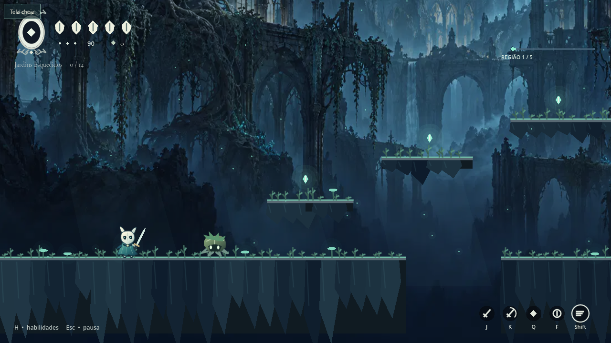
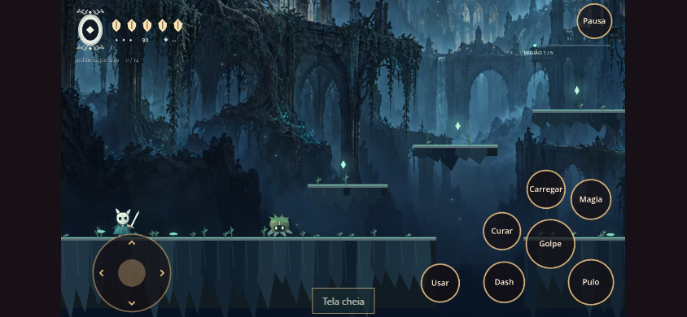

<div align="center">

# L U M E
### Ruínas do Eco

*Uma pequena luz em um reino que esqueceu o sol.*

[](https://github.com/Diasprogramador/lume-ruinas-do-eco/releases/latest)
[](https://godotengine.org/)
[](https://github.com/Diasprogramador/lume-ruinas-do-eco/actions/workflows/publish.yml)

**[▶ Jogar agora](https://Diasprogramador.github.io/lume-ruinas-do-eco/)** · **[↓ Baixar para Windows](https://github.com/Diasprogramador/lume-ruinas-do-eco/releases/latest)** · [Novidades](CHANGELOG.md)



</div>

## Entre nas ruínas

**Lume** é um jogo original de exploração e combate em 2D feito no Godot. Atravesse jardins esquecidos, ilhas de cogumelos, minas de cristal, aquedutos congelados e uma cidadela em chamas. Encontre santuários, descubra caminhos elevados e enfrente o guardião de cada região.

Um projeto independente inspirado na atmosfera dos metroidvanias, com personagens, cenários, nomes e trilha próprios. Não é uma versão oficial de Hollow Knight e não tem vínculo com a Team Cherry.

## Escolha como jogar

| Plataforma | Como começar |
|---|---|
| **PC, pelo navegador** | Abra **Jogar agora**, clique em **Entrar nas ruínas** e depois em **Jogar**. |
| **Android** | Abra **Jogar agora** no Chrome → **Instalar no Android**. Baixe o jogo offline e adicione à tela inicial. |
| **iPhone / iPad** | Abra **Jogar agora** no Safari → **Instalar no iPhone / iPad**. Use **Compartilhar → Adicionar à Tela de Início** (ative **Abrir como App**, se aparecer). |
| **Windows 10/11, 64 bits** | Baixe `Lume-v1.0.0-Windows-x64.zip`, extraia a pasta e abra `Lume.exe`. Não precisa instalar Godot. |

O navegador precisa de **WebGL 2** e **WebAssembly**. A primeira abertura baixa o motor e o conteúdo do jogo; a velocidade depende da conexão e do aparelho. A edição móvel é um aplicativo web instalável, sem APK ou publicação em lojas.

### Instalar e jogar sem internet

1. Na página inicial, escolha **Instalar no Android** ou **Instalar no iPhone / iPad**.
2. Toque em **Baixar jogo offline** e aguarde a confirmação. O download completo ocupa cerca de **41 MB**, incluindo o motor.
3. Adicione à tela inicial pelo botão de instalação, quando disponível, ou siga as instruções do navegador mostradas na página.
4. Abra pelo ícone **Lume**. No iOS, o aplicativo pode ter armazenamento separado do Safari: confira o download offline também dentro do aplicativo instalado.
5. Jogue na horizontal. Use **Verificar atualizações** com internet para baixar uma nova versão. Se houver atualização pendente, feche todas as janelas do Lume e abra novamente.

Se você abriu o link dentro do WhatsApp ou Instagram, abra no Safari/Chrome para instalar. O navegador pode remover o download para liberar armazenamento; nesse caso, baixe novamente. A campanha ainda dura a sessão, mesmo no aplicativo instalado. A instalação/offline foi validada em navegador automatizado; a instalação pela tela inicial em iPhone/iPad físico ainda precisa de validação.

## Âmbar & noite · edição de toque

Uma interface própria para celular: tons de âmbar, botões circulares, direcional virtual e menos partículas. O jogo mantém as proporções ao mudar o tamanho da tela. Na vertical, uma orientação pede para girar o aparelho; a partida pausa ao girar ou sair da aba.

- **Direcional esquerdo:** andar e mirar para cima ou para baixo.
- **Golpe / Pulo / Dash / Magia:** ações principais à direita.
- **Carregar:** segure e solte para o corte solar.
- **Curar:** segure parado, no chão, com energia disponível.
- **Usar:** descansar no santuário ou atravessar uma passagem.
- **Pausa:** abre o menu e libera os dedos para evitar comandos presos.

É possível mover, pular e atacar usando vários dedos ao mesmo tempo.



## Um mundo em cinco regiões

| Região | Ambiente | Guardião |
|---|---|---|
| Jardins Esquecidos | Ruínas cobertas de musgo e terraços elevados | Guardião do Eco |
| Brejo das Lanternas | Ilhas, fungos luminosos e poços tóxicos | Vigia dos Esporos |
| Minas de Ametista | Cristais, colunas e passagens nas alturas | Sentinela de Vidro |
| Aquedutos do Inverno | Pontes quebradas, neve e gelo | Cavaleiro da Geada |
| Cidadela das Cinzas | Torres, fornalhas e abismos | Última Brasa |

**78 sementes**, cinco guardiões e dez desenhos de criaturas. Cada fase tem vários santuários. Vença o chefe e use a passagem à direita para continuar; a entrada à esquerda permite voltar à região anterior.

## A arte do combate

| Ação | Teclas padrão no PC |
|---|---|
| Mover / mirar | WASD ou setas |
| Pular / salto duplo | Espaço ou Z |
| Atacar | J, X ou clique esquerdo |
| Corte carregado | Segurar K e soltar |
| Magia | Q ou clique direito |
| Magia ascendente / mergulho | Cima + magia / baixo + magia no ar |
| Dash | Shift ou C |
| Curar | Segurar F parado no chão |
| Interagir | E |
| Ajuda / pausa | H / Esc |

Os golpes recarregam energia. Magias e cura custam **30 de energia**; o máximo é 90. Atacar para baixo no ar e acertar um inimigo provoca um rebote. A ajuda dentro do jogo explica combos, escalada e habilidades.

Em **Configurações**, personalize as teclas, os volumes e a tremida da câmera. A loja oferece capas cosméticas compradas com sementes; não há compras com dinheiro real.

## Salvamento e limites da primeira versão

Carteira, sementes, capas e configurações são salvas no dispositivo. **A posição, os santuários e a campanha recomeçam quando o jogo é fechado.** No navegador, limpar os dados do site também apaga essas preferências; navegação privada pode impedir o salvamento.

Esta é a primeira versão pública jogável. PC e controles móveis foram validados com testes automatizados e emulação de navegador. Ainda não há validação em celulares físicos ou Safari/iOS. As cinco famílias têm visuais próprios; os guardiões compartilham a base de comportamento de combate.

Encontrou um problema? [Abra uma issue](https://github.com/Diasprogramador/lume-ruinas-do-eco/issues) com o aparelho, navegador, fase e o que aconteceu.

## Desempenho

- Terreno separado em blocos com comandos de desenho reutilizados.
- Animações de inimigos suspensas fora da tela e partículas limitadas.
- Modo econômico automático em dispositivos de toque.
- Texturas com compressão e resolução limitada na exportação.
- Imagens de documentação, testes e ferramentas fora dos pacotes do jogo.
- Renderização web limitada a 1280 × 720, evitando o custo de resolução excessiva em telas de alta densidade.

O pacote de conteúdo do jogo tem aproximadamente **2,7 MB** na exportação inicial; o motor WebAssembly é baixado separadamente. Isso não representa o tamanho total do download nem uma promessa de FPS em qualquer aparelho.

## Rodar o projeto

Use **Godot 4.6.1 Standard**, abra `project.godot` e pressione **F5**. O projeto não precisa de serviços externos nem de chaves de API.

```sh
godot --headless --path . --editor --import --quit
godot --headless --path . --script res://tests/gameplay.gd
godot --headless --path . --script res://tests/preferences.gd
godot --headless --path . --script res://tests/levels.gd
godot --headless --path . --script res://tests/mobile.gd
```

As quatro suítes verificam combate, configurações, loja, progressão e multitoque sem sobrescrever o perfil real do jogador.

Para exportar, instale os templates oficiais de **4.6.1**, crie `build/web` e `build/windows`, e use os presets **Web** e **Windows**. `python tools/install_templates.py` baixa somente os arquivos necessários dos templates oficiais. O workflow do GitHub testa e publica a versão web a cada atualização de `main`.

```sh
godot --headless --path . --export-release Web build/web/index.html
python tools/prepare_web.py
godot --headless --path . --export-release Windows build/windows/Lume.exe
```

## Créditos

- Jogo desenvolvido no **Godot Engine**, sob licença MIT. Avisos em [THIRD_PARTY](THIRD_PARTY/).
- Fonte **Cormorant Garamond**, de Christian Thalmann, sob [SIL Open Font License](assets/fonts/OFL.txt).
- Ilustrações de fundo originais geradas com assistência de IA; [direção de arte e prompts](assets/ART_DIRECTION.md).
- Criaturas e protagonista em arte vetorial própria; música e efeitos sintetizados para o projeto.

---

<div align="center">Feito para explorar, errar, voltar ao santuário — e tentar de novo.</div>
